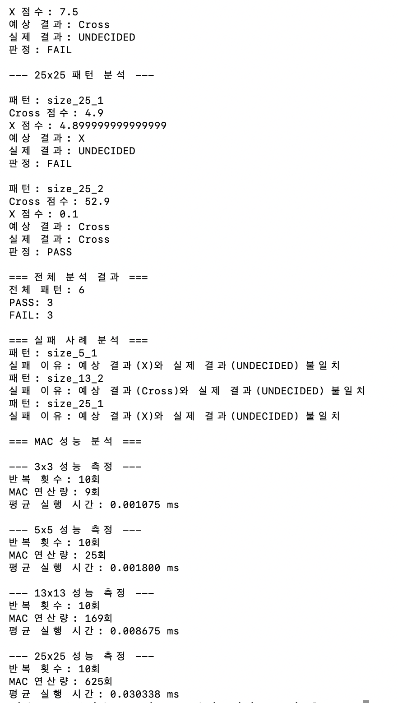
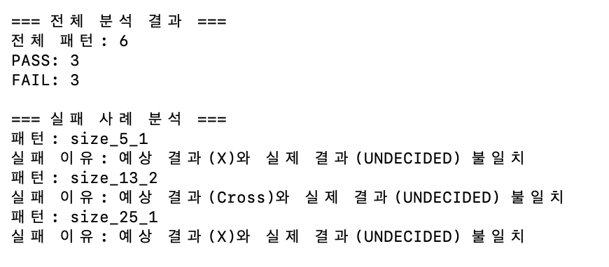
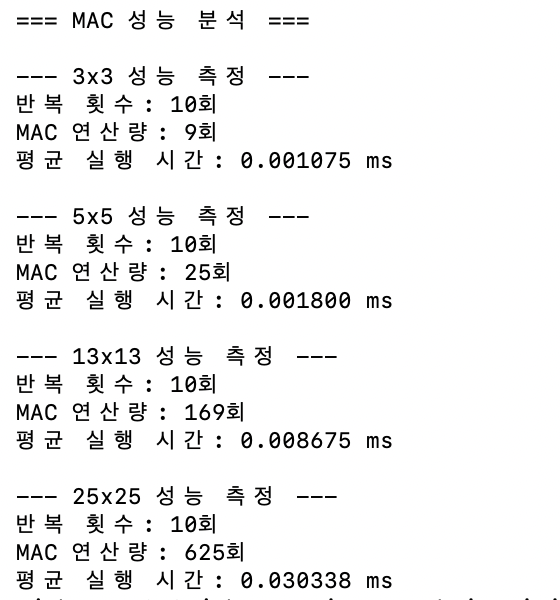

# Mini NPU Simulator

## 1. 프로젝트 소개

Mini NPU Simulator는 인공지능의 패턴 인식 과정을 간단하게 시뮬레이션하는 프로그램입니다.

MAC(Multiply-Accumulate) 연산을 활용하여 입력 패턴과 기준 필터 사이의 유사도를 계산하고, 계산 결과를 바탕으로 패턴을 분류합니다.

또한 다양한 크기의 행렬을 처리하고 실행 시간을 측정하여 연산량과 성능의 관계를 분석합니다.

## 2. 개발 목적

- MAC 연산의 원리 이해
- 행렬 기반 패턴 인식 과정 구현
- Python을 활용한 데이터 처리 및 검증
- JSON 파일을 활용한 데이터 관리
- 행렬 크기에 따른 연산 성능 비교

## 3. 개발 환경

| 항목 | 내용 |
|---|---|
| 프로그래밍 언어 | Python |
| 데이터 저장 | JSON |
| 사용 라이브러리 | json, time |
| 실행 환경 | macOS Terminal |
| 개발 도구 | Visual Studio Code |

외부 라이브러리 없이 Python 표준 라이브러리를 사용하여 구현했습니다.

## 4. 주요 기능

### 4-1. MAC 연산 / 프로그램 메뉴

입력 패턴과 필터의 같은 위치에 있는 값들을 각각 곱한 후 모든 결과를 더합니다.

MAC 연산 공식:

MAC = Σ (Input[i][j] × Filter[i][j])
--------------------------------------------------------------------

프로그램 실행 시 메뉴를 통해 원하는 기능을 선택할 수 있습니다.

- 1번: 사용자 입력 모드 (3×3)
- 2번: JSON 데이터 분석 모드
- 0번: 프로그램 종료

### 4-2. 사용자 입력 모드

사용자가 직접 3×3 크기의 필터 A, 필터 B와 입력 패턴을 입력할 수 있습니다.

두 필터의 MAC 점수를 비교하여 A, B 또는 UNDECIDED로 결과를 분류합니다.

### 4-3. JSON 데이터 분석

data.json 파일에 저장된 패턴과 필터 데이터를 불러와 자동으로 분석합니다.

지원하는 행렬 크기:
- 5×5
- 13×13
- 25×25

각 패턴에 대해 Cross와 X 필터의 점수를 계산하고 예상 결과와 비교합니다.

### 4-4. 데이터 검증 및 라벨 정규화

- JSON 파일이 존재하는지 확인합니다.
- JSON 형식이 올바른지 확인합니다.
- 행렬의 행과 열 크기를 검증합니다.
- 숫자가 아닌 값이 포함되어 있는지 검사합니다.
- '+'와 'cross'를 'Cross'로 통일합니다.
- 'x'를 'X'로 통일합니다.

#### 라벨 정규화 함수의 분리 이유

`normalize_label()` 함수는 입력된 라벨을 Cross 또는 X로 통일하는 역할을 담당합니다.

이 기능을 별도의 함수로 분리한 이유는 다음과 같습니다.

- **재사용성:** 사용자 입력과 JSON 데이터 처리 등 여러 위치에서 동일한 정규화 기능을 사용할 수 있습니다.
- **유지보수:** 라벨 변환 규칙이 변경되어도 해당 함수만 수정하면 됩니다.
- **확장성:** 새로운 라벨이 추가되더라도 기존 판정 코드의 변경을 최소화할 수 있습니다.

#### 새로운 라벨 추가 절차

새로운 라벨을 추가할 경우 다음 순서로 진행합니다.

1. `normalize_label()`에 새로운 라벨의 변환 규칙을 추가합니다.
2. 정규화된 라벨이 필터 및 판정 과정에서 올바르게 처리되는지 확인합니다.
3. 새로운 라벨이 포함된 테스트 데이터를 추가합니다.
4. 예상 결과와 실제 결과가 일치하는지 확인합니다.

### 4-5. PASS / FAIL 판정

계산된 결과와 JSON에 저장된 예상 결과를 비교합니다.

- PASS: 실제 결과와 예상 결과가 일치하는 경우
- FAIL: 실제 결과와 예상 결과가 일치하지 않는 경우
- UNDECIDED: 두 필터의 점수 차이가 매우 작은 경우

부동소수점 계산 오차를 고려하여 1e-9의 허용 오차를 적용했습니다.

#### 모드별 출력 및 판정 방식

본 프로그램은 사용자 입력 모드와 JSON 데이터 분석 모드로 구분됩니다.

**1. 사용자 입력 모드**

- 사용자가 3×3 크기의 필터 A, 필터 B 및 입력 패턴을 직접 입력합니다.
- 두 필터의 MAC 점수를 각각 계산합니다.
- 점수를 비교하여 Cross, X 또는 UNDECIDED 결과를 출력합니다.
- 단일 패턴을 분석하므로 전체 PASS / FAIL 집계는 수행하지 않습니다.

**2. JSON 데이터 분석 모드**

- JSON 파일에 저장된 여러 패턴을 자동으로 분석합니다.
- 각 패턴의 예상 결과와 실제 분류 결과를 비교합니다.
- 결과가 일치하면 PASS, 일치하지 않으면 FAIL로 판정합니다.
- 모든 패턴의 총 개수, PASS 개수 및 FAIL 개수를 집계합니다.
- 실패한 패턴과 실패 이유도 함께 출력합니다.

**3. 동점 및 허용 오차 처리**

두 MAC 점수의 차이가 1e-9 이하인 경우 특정 패턴으로 단정하지 않고 UNDECIDED로 처리합니다.

JSON 분석 모드에서는 UNDECIDED가 예상 결과와 다르면 FAIL로 집계됩니다.

### 4-6. 성능 분석

각 크기의 입력 패턴과 필터 A를 사용하여 MAC 연산을 10회 반복합니다.

MAC 연산량은 필터 1개를 기준으로 N×N으로 계산하며,
반복 실행 시간을 측정한 뒤 평균 실행 시간을 밀리초(ms) 단위로 표시합니다.

#### 성능 측정 범위 및 기준

본 프로젝트에서는 MAC 연산 자체의 실행 시간을 확인하기 위해 `time.perf_counter()`를 사용합니다.

성능 측정 시 JSON 파일 읽기, 사용자 입력 및 데이터 준비 과정은 측정 대상에서 제외합니다.

실제 측정 구간은 `mac_operation()` 함수가 실행되는 부분으로 한정합니다.

이를 통해 파일 입출력이나 사용자 입력에 영향을 받지 않고 행렬 연산에 소요되는 시간을 비교할 수 있습니다.

각 행렬 크기별로 MAC 연산을 10회 반복하고, 전체 실행 시간을 반복 횟수로 나누어 평균 실행 시간을 계산합니다.

## 5. 프로그램 실행 방법

### 1단계. 프로젝트 폴더 이동

터미널에서 프로젝트 폴더로 이동합니다.

```bash
cd ~/Desktop/Mini_NPU_Simulator
```

### 2단계. 프로그램 실행

```bash
python3 main.py
```

### 3단계. 데이터 파일 확인

main.py와 data.json 파일이 같은 폴더에 있어야 합니다.

## 6. 성능 분석 결과

실행 환경에서 측정한 결과입니다.

| 행렬 크기 | MAC 연산량 | 평균 실행 시간 |
|---|---:|---:|
| 3×3 | 9회 | 0.002012 ms |
| 5×5 | 25회 | 0.003504 ms |
| 13×13 | 169회 | 0.015925 ms |
| 25×25 | 625회 | 0.054763 ms |

행렬 크기가 증가할수록 MAC 연산량과 실행 시간이 증가하는 것을 확인했습니다.

실행 시간은 컴퓨터 환경과 실행 상태에 따라 달라질 수 있습니다.

## 7. 시간 복잡도 분석

MAC 연산은 2차원 행렬의 모든 원소를 순회하며 계산합니다.

행렬의 크기가 N×N인 경우 총 N²개의 원소를 처리합니다.

- 바깥쪽 반복문: N회
- 안쪽 반복문: N회
- 전체 연산 횟수: N × N = N²

따라서 MAC 연산의 시간 복잡도는 O(N²)입니다.

행렬 크기가 증가하면 처리해야 하는 원소의 수도 제곱에 비례하여 증가합니다.

각 원소를 한 번씩 계산하므로 행렬의 크기가 커질수록 연산량은 제곱에 비례하여 증가합니다.

이번 프로젝트에서는 3×3부터 25×25까지의 행렬을 사용하여 이러한 특성을 확인했습니다.

## 8. 실패 사례 분석

현재 실행 결과 총 6개의 패턴 중 3개가 PASS, 3개가 FAIL로 나타났습니다.

실패한 패턴은 다음과 같습니다.

| 패턴 | 예상 결과 | 실제 결과 | 원인 |
|---|---|---|---|
| size_5_1 | X | UNDECIDED | 두 점수의 차이가 허용 오차 이내 |
| size_13_2 | Cross | UNDECIDED | 두 점수의 차이가 허용 오차 이내 |
| size_25_1 | X | UNDECIDED | 두 점수의 차이가 허용 오차 이내 |

실패 원인을 분석한 결과, 세 패턴 모두 두 필터의 MAC 점수가 매우 비슷했습니다.

컴퓨터의 부동소수점 연산에서는 소수점 아래의 미세한 오차가 발생할 수 있습니다.

이를 고려하여 두 점수의 차이가 1e-9 이하인 경우 특정 패턴으로 단정하지 않고 UNDECIDED로 판정하도록 구현했습니다.

이는 잘못된 분류를 방지하기 위한 비교 정책입니다.

## 9. 프로젝트 파일 구성

```text
Mini_NPU_Simulator/
├── main.py
├── data.json
└── README.md
```

- main.py: MAC 연산, 패턴 분류, 데이터 검증 및 성능 분석 기능
- data.json: 필터와 입력 패턴 데이터
- README.md: 프로젝트 설명 및 실행 방법

## 10. 프로젝트 마무리

이번 프로젝트를 통해 MAC 연산을 활용한 간단한 패턴 인식 과정을 구현했습니다.

또한 JSON 데이터 처리, 행렬 검증, 부동소수점 오차 처리 및 실행 시간 측정을 경험했습니다.

특히 행렬 크기에 따른 연산량과 실행 시간의 관계를 직접 확인하며 알고리즘의 시간 복잡도에 대한 이해를 높일 수 있었습니다.


## 11. 실행 화면

### 11-1. JSON 패턴 분석 결과

5×5, 13×13, 25×25 패턴에 대한 MAC 점수 계산 및 분류 결과입니다.



### 11-2. PASS / FAIL 및 실패 사례 분석

전체 패턴의 분석 결과와 실패한 패턴의 원인을 확인할 수 있습니다.



### 11-3. MAC 성능 분석 결과

행렬 크기에 따른 MAC 연산량과 평균 실행 시간을 비교한 결과입니다.


